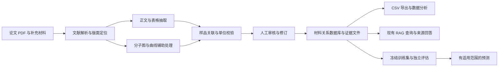

# 有机半导体文献数据工作台：可行性与分阶段实施规划

日期：2026-11-01。状态：建议方案，尚未实施。

本规划依据用户提供的 5 张需求截图、补充说明“有机半导体之类的”、本地源码核对，以及当日查询的开源项目官方资料编写。具体器件方向、目标性能和真实论文样本尚未确定；下文将这些内容列为待样本确认的选择，不视为用户已经指定。

## 1. 结论与第一份交付

**可以在现有 RAG Workbench 上继续开发，建议新增独立的“材料文献”模块。** 现有项目适合继续承担文档管理、问答、检索、来源追踪和审核界面；新增部分负责结构化实验数据、图表与结构、数据分析和预测。

第一份交付建议聚焦：**输入一篇真实论文 PDF（最好含补充材料），生成可逐项核对的材料/器件/性能记录，在页面显示，并导出 CSV。** 首版允许人工修订、人工补充结构，所有未识别项目明确留空。不要把“一篇论文演示成功”当成批量提取或预测准确的证明。

性能预测是后续独立阶段：先积累可比的实验记录，再验证模型对新材料或新工艺是否有预测能力。现有 RAG 可以找依据、解释相似案例，但不能直接充当经过验证的数值预测模型。

本次仅新增本地规划文件；不修改业务代码、版本号、正式知识库、模型、密钥或 GitHub 封存版本，也未安装依赖或调用付费模型。

## 2. 把需求落实为可验收能力

| 用户需求 | 对应能力 | 首版边界 |
| --- | --- | --- |
| 从论文提取材料性能 | 按目标字段抽取值、单位、样品和测试方法 | 正文、普通表格优先；扫描件和复杂图表单独验收 |
| 同时说明工艺和条件 | 建立材料—样品—制备步骤—器件—测量之间的关系 | 多个样品不能混成一条“材料最佳性能”记录 |
| 保存数据和结构 | 存储分子/聚合物信息、器件拓扑及性能观测 | 小分子结构、聚合物重复单元、器件结构分开表示 |
| CSV 输出和页面展示 | 可编辑数据表、证据定位、筛选、导出 | CSV 是交换格式，完整关系保存在数据库及 JSON 中 |
| 不同图表分析提取 | 区分表格识别、曲线数字化、结构图识别 | 先保留原图；读数经校准和审核后才入正式数据集 |
| 输入新东西预测性能 | 根据结构、配方、工艺、器件和测试条件建立专门模型 | 缺少训练覆盖或必要输入时，给相似案例，不编造预测数值 |

### 首批领域范围

“有机半导体”仍较宽。建议保留共同的数据底座，首批只完成一个器件方向和 2–3 个指标：

| 候选方向 | 可选首批指标 | 必须同时保留的上下文示例 |
| --- | --- | --- |
| 有机场效应晶体管（OFET） | 载流子迁移率、阈值电压、开关比 | 电子/空穴、测试与提取方法、线性/饱和区、沟道几何、介电层、偏压与测试环境 |
| 有机光伏（OPV） | PCE、Voc、Jsc；FF 作为配套指标 | 给体/受体、混合比例、活性层、制备与退火、照明和有效面积、统计口径 |
| 其他有机半导体器件 | 由首篇论文确定 | 延用共同模型，再增加领域模板 |

**规划暂用 OFET 作字段示例，不代表已经决定做 OFET，也不同时承诺覆盖 OLED、OPV 和所有聚合物体系。** 一旦收到样本，M0 选择具体方向并冻结首批字段。

迁移率提取本身存在方法和非理想器件效应，不能只按名称合并数字；相关研究已专门讨论 FET 迁移率提取的常见问题。[原始研究讨论](https://www.nature.com/articles/nmat5035)

## 3. 本地代码能复用什么

本次核对：本地版本仍为 `0.1.10`，HEAD 为 `0b9890d`，已有未提交本地改动。下表是源码现状，不是新增功能完成清单。

| 当前模块 | 已有能力 | 本次扩展方式 |
| --- | --- | --- |
| `infrastructure/parsing.py` | TXT/MD/PDF/DOCX/EPUB/HTML 解析；PDF 用 `pypdf.extract_text()` | 保留普通问答解析；另接研究文献解析器，输出表格、图像、版面坐标 |
| `domain/models.py` | Document、Section、Chunk、引用与回答模型 | 新增材料领域模型，避免把材料数据硬塞入 Chunk 文本 |
| `infrastructure/repository.py` | SQLite 文档、会话、设置；现有 schema version 为 2 | 材料模块独立数据库和迁移版本，不直接改写旧库结构 |
| `application/knowledge.py`、`pipeline.py` | FAISS/BM25 检索、证据判断、引用回答 | 支持查询文献与已审核记录；不让 Top-K 问答检索决定整篇抽取覆盖范围 |
| `application/packs.py` | 原件、来源清单、内容哈希、草稿包与构建流程 | 复用来源/版本管理思路；材料 schema 与评测集另行定义 |
| `pack_authoring.py`、`pack_review.py`、`pack_evaluation.py` | 草稿、人工审核、冻结和评测 | 复用审核与冻结机制；新增字段、关系、数值、单位的抽取评测 |
| `infrastructure/llm.py`、`domain/ports.py` | 文本模型调用、JSON mode、流式和错误处理 | 复用文本接口；图像输入能力另设适配器，不能假设当前模型可看图 |
| `application/generation.py` | 聊天后台线程、取消和状态 | 可借用交互模式；长时间解析任务需持久化任务状态和独立进程 |
| Streamlit 页面、桌面启动器 | 本地工作台、导航、主题、桌面入口 | 继续使用；材料审核页逐步加入，不先迁移整个前端 |

现有代码**尚不具备**：PDF 表格单元格与图像坐标链路、材料/样品/器件关系模型、分子结构识别、曲线数字化、材料回归训练与模型注册。现有页码引用也不能等同于字段级证据。

先前本地复现的两项缺陷，本次静态检查相关路径仍存在，应在 M0 修复：

1. 输出引用错误被算成服务故障，可能释放已使用 holdout。材料评测不能继承这种记账方式。
2. 管理未激活知识包时，实际 provider 与报告的模型配置可能不一致。提取/预测记录必须能对应实际执行配置。

两项问题的后续修复参见[材料首版验证记录](../../MATERIALS_MVP_VERIFICATION.md)。此前 `495 passed / 3 skipped` 是 2026-10-27 的历史结果；这份规划编写时没有重跑测试或浏览器验收。

## 4. 建设路线与开源复用

### 路线比较

| 路线 | 优点 | 代价 | 判断 |
| --- | --- | --- | --- |
| 继续扩展现有工作台，接入专用组件 | 复用现有 UI、管理和问答；可以逐阶段交付 | 需要自己实现材料关系、审核、数据版本和评测 | **推荐，本规划按此路线估算** |
| 以化学信息提取工具为主项目重新集成 | 可较快得到分子/反应抽取能力 | 仍需补器件、性能、条件、审核 UI；现有功能迁移成本高 | 作为组件参考，不整体迁移 |
| 直接换成另一套通用 RAG 平台 | 文档问答能力较齐全 | 核心的实验数据建模和预测问题仍未解决 | 当前没有足够收益 |

### 组件选择（2026-11-01 查询）

| 项目 | 适合复用的能力 | 采用方式与限制 |
| --- | --- | --- |
| [Docling](https://github.com/docling-project/docling) | PDF 版面、OCR、表格、图片及统一文档表示 | **默认解析候选**；保留 JSON，不仅导出 Markdown。代码 MIT，模型许可单独核对 |
| [LangExtract](https://github.com/google/langextract) | 按示例提取结构化文本信息，并对齐原文位置 | **默认文本抽取候选**，放在可替换适配器后；需补材料关系校验和当前 provider 的兼容验证。Apache-2.0 |
| [RDKit](https://github.com/rdkit/rdkit) | 解析/规范化分子表示、绘制结构、描述符和指纹 | **采用**；用于结构核验和后续特征，不代表它能仅凭结构预测器件性能。BSD |
| [Pint](https://github.com/hgrecco/pint) | 单位解析、换算和量纲检查 | **采用**；具体性能词表、温度语义和测试方法仍由本项目定义。BSD |
| [WebPlotDigitizer](https://github.com/automeris-io/WebPlotDigitizer) | 坐标轴校准、手动/辅助读数、CSV 导出 | **先独立本地使用并导入结果**；保存图像、校准信息和工程文件。前端 AGPL-3.0，云端 AI Assist 并非该开源前端的一部分 |
| [MolScribe](https://github.com/thomas0809/MolScribe) | 分子结构图片转 SMILES/MOL | 后续可选 worker，先做小分子测试；聚合物、R 基和混合结构保留原图并人工确认。代码 MIT |
| [OpenChemIE](https://github.com/CrystalEye42/OpenChemIE) | 化学论文中的分子/反应识别、图片与文本指代关联 | 作为图文关联方案候选，不整套替代材料工作台。代码 MIT；官方安装示例用 Python 3.9，先做隔离环境试验 |
| [ChemDataExtractor 2](https://github.com/CambridgeMolecularEngineering/chemdataextractor2) | 化学实体、性质与表格规则抽取 | 对固定性质模板作对照候选。MIT；官方声明支持 Python 3.9–3.11，不直接装进当前 3.12 主环境 |
| [MinerU](https://github.com/opendatalab/MinerU) | 复杂 PDF、OCR、表格和公式解析 | Docling 在实际样本上不足时作对照，不默认双解析整库；当前为含附加条件的 [MinerU Open Source License](https://github.com/opendatalab/MinerU/blob/master/LICENSE.md)，不是简单的纯 Apache-2.0 |
| [scikit-learn](https://github.com/scikit-learn/scikit-learn) | 基线回归、预处理、模型评估 | **预测阶段采用**；先建立可复现基线再评估更复杂模型。BSD-3-Clause |

选择依据：Docling 的结构格式包含表格、图片、布局和 provenance，可作为证据坐标底座。[结构说明](https://github.com/docling-project/docling/blob/main/docs/concepts/docling_document.md) LangExtract 可对齐文本来源，但对齐失败时可能没有 `char_interval`，必须检查，不能把“有 JSON”当作“有证据”。[官方说明](https://github.com/google/langextract/blob/main/README.md)

WebPlotDigitizer 提供线性/对数坐标校准和数据导出，适合先构建人工可控的曲线工作流。[官方操作说明](https://automeris.io/docs/digitize/) 第三方组件的代码、模型权重和训练数据分别记录版本与许可；本阶段只调查，没有安装或验证它们在本机的运行效果。

**仍需自己开发的部分**：领域 schema、跨段落/跨表格的样品关联、字段证据和修订、批量任务、导出契约、数据集冻结、预测适用范围与验收。这些恰好是本项目的业务价值。

## 5. 推荐架构与数据流



1. **完整抽取流程独立于聊天**：遍历所选文献的全部相关章节、表格和补充材料，记录处理覆盖范围。不能只抽取一次 RAG 返回的少量片段。
2. **解析结果先保存，再抽取**：按原件 SHA-256、解析器版本和配置生成缓存；页面坐标、正文和单元格保留映射。重新分块不能使已审核证据失效。
3. **候选与正式记录分开**：LLM 返回候选，规则校验、原文核对和人工批准后进入已审核集合。缺失信息为 `null + missing_reason`，不补成 0 或“常温”。
4. **多轮提取分工明确**：先定位材料、样品标签及实验方法，再提取性能，最后匹配关系；遇到无法确定的样品关联，保留候选关联，交人工处理。
5. **长任务持久化**：任务记录 queued/running/needs_review/completed/failed/cancelled，记录页/表进度、耗时及实际模型。进程退出后将未完成任务标为可重试，按阶段缓存继续，不宣称无损恢复模型请求。
6. **失败隔离**：一个 PDF 或一页失败不回滚已审核的其他文献。重复执行不会重复生成正式记录，也不覆盖人工修订。
7. **模型配置分离**：文本抽取、图像识别、问答可用不同适配器；记录实际执行配置。远程处理界面说明将发送的文本/图片范围与估算调用量；本地 OCR/解析优先。

若首批论文以英文为主，单独检查现有中文 BGE 模型对英文性质名、化学名称和样品编号的检索表现；有实测不足后再更换或增加材料工作区的嵌入配置，不默认重建其他知识库。抽取任务中的论文文字始终是数据，不能覆盖受控字段模板和抽取规则。

### 数据库存储与既有库兼容

首版新增工作区级 `materials.sqlite3`，拥有自己的迁移记录；保持现有 `metadata.sqlite3` 和其 schema version 不变。数据量确有需要后再讨论 PostgreSQL，不提前部署多服务集群。

建议目录：

```text
data/<workspace>/materials/
  materials.sqlite3
  originals/<sha256>.<ext>
  parsed/<source-sha>/<parser-config-hash>/
  assets/                         # 页图、表格、分子图、曲线裁图
  runs/<run-id>/                   # 配置、状态、错误与结果清单
  datasets/<snapshot-id>/          # 审核数据快照、分组与评测划分
  models/<model-id>/               # 已验证模型及训练信息
  exports/<export-id>/
```

材料模块持有自己的不可变原件副本并按哈希去重；从既有知识库导入时复制一次，不以可能进入旧回收站的文件作为唯一证据。向现有 RAG 发布索引是可重建的派生步骤，失败不撤销材料审核结果。移除检索副本不会悄悄删除材料原件和数据；材料模块另有明确的归档操作。

## 6. 数据模型：一条记录不等于一种材料

核心粒度是：**某篇论文中的某个样品/器件，在某种测试方法和条件下得到的一项性能观测。** 同一种材料换工艺、器件或测试条件，必须保留不同记录。

| 实体 | 关键字段与关系 |
| --- | --- |
| Paper / SourceFile | 标题、DOI、年份、原件哈希、文件角色（正文/补充材料）、PDF 页序与印刷页码 |
| Material | 文内名称/别名、材料类别、原始与规范化 SMILES、结构图、结构确认状态；名称首先限定在论文内，跨文献合并需结构或人工依据 |
| MaterialComponent | 共混材料的组分及比例；聚合物另存重复单元、连接点、Mn/Mw/分散系数等已报告信息 |
| Sample | 论文中的样品标签、材料/配方、批次与原文指代；一个材料可对应多个样品 |
| ProcessStep | 顺序、操作、溶剂/浓度、沉积方式、温度/时长、气氛、基底处理；每步独立证据 |
| Device | 样品、器件类型、有序层次、各层材料/厚度、电极、几何、源漏栅关系；不只存一个无语义的图片 |
| Measurement | 指标、载流子/方法/工作区、原始值和单位、规范值、范围/误差/上下限、平均或最佳值、样本数、环境和偏压等条件 |
| Evidence / FieldEvidence | 文档哈希、解析版本、页码、区域、文本跨度或单元格/图编号；按字段路径关联，一条记录可由多处证据共同支撑 |
| ReviewRevision | 提取候选、人工修改、批准/拒绝、审核时间及版本，原始候选不被覆盖 |
| DatasetSnapshot / ModelRun | 审核数据版本、任务定义、特征处理、分组划分、模型版本、评估结果及适用范围 |

关键约束：

- 性能值、单位、样品、测试方法和重要条件都各自具有来源，不能拿一个页码替代全部字段证据。
- PDF 坐标统一为页内归一化左上原点，并保存页尺寸、旋转、裁剪及渲染变换；核验页图和高亮是否一致。原文印刷页码与 PDF 页序分开。
- SMILES 的语法有效不代表识别结果正确。小分子要对照原图；聚合物重复单元、R 基未解析、共混体系必须保留未解析信息，不能伪装成一个确定的小分子。
- `reported`（原文报告）、`digitized`（图上读数）、`derived`（按公式计算）、`predicted`（模型预测）分别标识；预测结果不回流为实验真值。
- 不同来源冲突时并列保留：例如正文与表格值不同、最佳值与平均值不同、理论值与实验值不同，不自动取最大值或平均。
- 综述引用的其他研究结果标成二手证据，与作者本次实验区分；跨论文重复转载的数据需要去重标识。
- 单位统一使用确定性转换；光学/电化学/计算能隙等不同定义、不同参考标尺的能级不得仅因为单位相同就合并。

### CSV 输出契约

提供两种下载，避免一个扁平文件损失关系：

1. **简明性能表 `measurements.csv`**：一行一项观测，含 `measurement_id, paper_id, sample_id, device_id, property, method, regime, value_raw, unit_raw, value_normalized, unit_normalized, statistic, origin_type, review_status, evidence_ids`，以及当前领域常用条件列。
2. **完整数据包 ZIP**：以带 `schema_version` 的 `dataset.json` 作为可回读的完整数据表示，必须包含 Paper、SourceFile、Material、MaterialComponent、Sample、ProcessStep、Device、Measurement、Evidence、FieldEvidence 及导出记录对应的审核版本，所有引用实体一并打包。另附 `papers.csv / source_files.csv / materials.csv / material_components.csv / samples.csv / devices.csv / process_steps.csv / measurements.csv / conditions.csv / evidence.csv / field_evidence.csv / curves.csv / manifest.json` 作为表格视图，以及字段字典和单位定义。主文与 SI、样品配方、组分比例和字段证据均使用稳定 ID 关联。

中文 CSV 使用兼容 Excel 的 UTF-8 BOM。缺失值留空并带原因；不导出字符串 `None` 作为数值。人工确认前的候选可单独下载，但不能混入默认“已审核”导出或训练集。完整导出需验证重新导入后的实体、关系和字段证据一致且无悬空引用，不能只验证文件可打开。原件是否随包携带作为显式导出选项；未携带时保留哈希和来源清单，导入端明确显示原件待补充，不能声称已经能离线查看原 PDF。

## 7. 图表与结构按难度分层交付

| 内容 | 实现路径 | 验收重点 |
| --- | --- | --- |
| 正文中的数值 | 文本抽取 + 字段证据 + 单位规则 | 数值/样品/条件对应正确 |
| 普通表格 | Docling 结构表 + 表头/脚注关联 | 多级表头、合并单元格、单位、脚注和跨页归属 |
| 扫描表格 | OCR 后进入同一审核流程 | 标出 OCR 来源；特别检查负号、指数、小数点和相似字符 |
| 折线/散点/器件特性曲线 | 保留图 → 标定坐标 → 辅助读数 → CSV 导入 | 线性/对数、单位、曲线与图例/样品对应、扫描方向、误差条 |
| 分子结构图 | 人工确认 SMILES；后续 MolScribe 辅助 | 结构与文中材料标签对应；R 基、键型、电荷、聚合物范围 |
| 器件示意图 | 抽取层次和电极关系，展示可修改示意 | 与文字、图注一致；未知尺寸不推测 |
| AFM/SEM/GIWAXS 等复杂图 | 首版保留图和论文明确报告的参数 | 不承诺从任意图自动恢复形貌/晶体参数；需要另建专门分析任务 |

图上读数是近似结果。保存校准点、坐标类型、区域、读数流程和审核人；坐标刻度无法辨认时不输出伪精确数值。若从曲线进一步计算迁移率等参数，应另建版本化计算步骤，保存公式、拟合范围、所需几何/电容等输入、假设和误差，不覆盖作者报告值。

## 8. 页面规划

沿用现有本地工作台、双主题和侧边栏，新增“材料文献”入口，内部包含：

1. **文献与任务**：上传正文/补充材料、选择模板、查看解析/提取进度、失败页和重试；显示真实处理范围。
2. **提取审核**：宽屏左侧原文页图/表格/图片，右侧记录和字段；点击值定位证据，支持修订、拆分样品、批准或拒绝。
3. **数据与分析**：按材料、器件、方法、工艺和条件筛选，展示分布、散点、可比组之间的对照以及缺失字段；提供 CSV/完整包下载。
4. **结构与曲线**：分子原图和重绘并排，器件示意、已校准曲线和原始图可核对；复杂编辑可先用独立工具。
5. **预测实验**：数据满足准入后开放；选择任务、输入新样品条件，展示预测范围、相似实验、模型版本和适用性说明。

首版优先完成前两页与导出。数据分析页面只聚合同一口径的数据；不会把 OFET 与 SCLC 迁移率、实验和计算结果放进同一平均值。

继续用 Streamlit 原生组件；只在证据区域标注、分子编辑等原生能力不足处增加局部组件。窄屏改为原文/记录切换视图，避免双栏压缩；检验侧栏折叠/展开、键盘编辑、长表滚动和弹窗遮挡。暂不需要整体重写 React、多人账户或云服务。

## 9. 预测方案与启动条件

### 第一层：相似案例辅助

结构指纹、工艺、器件和条件检索，展示相似实验及其证据。此层可以较早交付，但展示的是已报告案例，不标成新材料的预测准确率或预测区间。

### 第二层：单任务监督预测

只选一种器件和一种定义明确的目标，例如一个测试口径下的 OFET 迁移率。输入由已确认结构描述符/指纹、配方、工艺、器件和测量条件组成。以均值/中位数和简单线性模型为基线，再比较树模型；不先训练大型神经网络。

对正值且跨数量级的迁移率，可评估对数目标，必须同时说明原始尺度结果，并正确处理低于检测限、0 和缺失值。聚合物的重复单元特征不能代替分子量、分布、规整度和工艺；字段不足时缩小任务范围。

### 预测验收门槛

- 目标定义、测试口径与必要输入明确；存在足够的独立论文/样品/化学体系覆盖。不能仅凭总行数决定可预测。
- 按论文/批次分组，阻断同一器件的重复测量与同一曲线点跨训练/测试泄漏；针对“新材料”额外检验分子/骨架分组，必要时用时间外推测试。
- 模型预处理、缺失填补、特征筛选只在训练折拟合；保留一次性冻结测试集，输出错误不能重置其使用记录。
- 报告 MAE/RMSE 等目标相关误差、基线对照、逐组误差和样本覆盖；若输出预测区间，要实测区间覆盖，不能拿 LLM 自评分充当可信度。
- 在冻结测试集上有稳定的基线改进，并达到 M0 与需求方约定的业务容差，才称为“可用预测”。否则只交付实验报告和相似案例功能。
- 对训练分布外的新结构或工艺、缺失关键条件的输入，明确显示“当前模型不适用/信息不足”，不输出确定的高精度数值。

公开数据可作试验对照。例如 HOPV15 同时包含有机光伏文献实验和计算数据，可参考其字段及做 OPV 路线的基线；它不等同于本项目的 OFET 训练集，也不能将计算值直接当实验标签。[原始数据论文](https://www.nature.com/articles/sdata201686) 未经口径、重复和来源审查，不把外部数据自动并入正式训练集。

## 10. 分阶段排期、任务与出口

以下为 **1 名熟悉项目的开发者、需求方可提供样本并及时核对** 时的初步工程人日估算，不含等待论文、批量人工标注、GPU/模型下载、外部服务故障。M0 结束后重估；并非交付日期承诺。

| 阶段 | 工作与交付 | 建议人日 | 完成条件 |
| --- | --- | --- | --- |
| M0：范围与基线 | 选器件/指标；核对 3–5 篇代表论文及 SI；定义字段/人工真值；Docling 和备选小样对比；修复两个已有评测/模型归属问题 | 1–2（遇环境冲突另计） | 有真实样本、确定领域模板、解析输出/耗时记录和冻结验收口径 |
| M1：单篇端到端演示 | 专用解析适配器；正文/普通表格抽取；材料数据库；人工核验；结构原图/手工确认；CSV/JSON；页面证据定位 | 5–8 | 一篇真实论文可演示从导入到核对和导出；明确自动/人工/未识别字段 |
| M2：多篇数据工作台 | 多论文/SI 关联、样品与别名管理、单位与冲突校验、版本修订、批量任务和筛选分析 | 4–7 | 批量失败隔离、重复导入稳定、审核结果可冻结与完整导出 |
| M3：曲线和结构增强 | WebPlotDigitizer 结果对接、校准元数据、复杂表格测试；小分子图识别候选与人工核对 | 5–10 | 选定图类型有读数误差验收；不支持的图和结构有明确边界 |
| M4：预测试验 | 数据可用性评估、特征/分组、基线、独立测试、适用域及预测页 | 5–10，满足数据门槛才开始 | 有对照评估和可复现模型；不达标则不宣称可预测 |

**建议先交付 M0 + M1，约 6–10 个工程工作日的范围。** M2 后才是可持续整理多篇论文的工作台。M3 可以按论文实际需要前移部分能力，例如正文性能只出现在图中时，先使用人工标定读数，不为演示临时伪造自动结果。M4 不能按“又过了几天”自动启动。

### 建议文件拆分（均为拟新增，不是现有实现）

| 位置 | 职责 |
| --- | --- |
| `domain/materials.py` | 材料/样品/器件/测量/证据/审核模型 |
| `domain/material_ports.py` | 文献解析、抽取、结构识别和预测接口 |
| `infrastructure/literature/docling_adapter.py` | 版面、表格、图片和坐标统一 |
| `infrastructure/literature/langextract_adapter.py` | 带证据位置的候选抽取；模型能力与错误适配 |
| `infrastructure/material_repository.py`、`migrations/materials/` | 独立数据库、事务和迁移 |
| `application/materials/{extraction,validation,review,export}.py` | 业务链路与字段/关系规则 |
| `application/materials/jobs.py` | 持久任务、阶段缓存、取消和幂等 |
| `application/materials/{features,prediction,evaluation}.py` | 后续训练与预测，和聊天生成分开 |
| `ui/materials/{library,review,data,structures,prediction}.py` | 分页交互 |
| `knowledge_packs/organic_semiconductors/` | 字段模板、词表、抽取示例和公开评测说明；不默认收录私有 PDF |
| `tests/materials/` | 模型/关系/单位/来源/导出/任务/预测分组测试 |

既有入口修改限于 `bootstrap.py` 的服务装配、导航与新页面入口、必要的局部样式。材料依赖设为可选组；OCR/结构识别有版本冲突时用本地独立 worker，不强行升级主项目环境。桌面打包在功能稳定后验证，解析/结构模型作为独立可选资源管理，不将所有模型默认塞入便携包。

## 11. 验收与风险收敛

### 抽取验收

先建立 8–12 篇代表文献的人工核验集（若暂时只有一篇，先做演示，不宣称总体精度），覆盖多样品、表格脚注、补充材料、方法分散、单位变体和必要的扫描页。按论文划分开发与最终验收集。

建议初始目标，M0 按样本调整并冻结：

- 在人工标注的可判定记录上，自动抽取“值＋单位＋正确样品”的精确率 ≥95%、召回率 ≥85%；另外独立报告工艺、测试方法/条件、关系关联正确率和人工修订耗时。不能只报解析成功率。
- 所有已审核非空字段具有可回到原页/表/图的证据；这项机械完整性不等于字段事实已经正确。
- 标注中存在而系统留空的字段计入漏提；文献确未报告的字段保留 missing_reason，不凭常识补齐。
- 关键数值和单位经人工确认后，演示交付中不保留已知错误；自动候选错误率单独公开，不能用修订后数据冒充自动准确率。
- 报告样本数与按论文分组的结果；少量样本结果不外推到所有有机半导体论文。

### 图表与预测验收

曲线用已知数据生成的图及人工标定论文图对照，分别评估线性/对数、多曲线、图例关联和读数偏差；误差容差按轴范围、分辨率与业务用途在 M0/M3 冻结。读出数值成功不等于正确推导了材料物性。

预测验收遵循第 9 节，独立于抽取验收；一篇论文或几条曲线不能证明对新材料的泛化能力。

### 工程与 UI 验收

只对变更相关部分开展必要验证：旧问答/导入回归、新数据库迁移与导出回读、OCR/超时/中止、重复任务不重复入库、已审核记录不被重跑覆盖、字段证据定位、解析器缺失的明确提示；真实浏览器检查 1440px 和 700px、双主题、侧栏收放与审核表单。记录实际模型/版本、测试结果和截图，不用静态检查替代交互验收。

## 12. 开始实施前需要的材料

目前已知领域方向为有机半导体；尚未收到真正的论文 PDF。下一步最有价值的输入是：

1. 一篇最典型的论文 PDF 和其补充材料（若有），最好另有一篇格式较复杂的论文作对照。
2. 需求方最关心的 2–3 个性能，以及是否优先 OFET、OPV 或其他器件。
3. “结构”优先指分子/聚合物结构、器件结构，还是两者都要；本规划已预留两者，但自动化程度可以不同。
4. 新材料预测的实际输入：只有材料结构，还是会同时提供配方、制备、器件和测试条件。

这些输入用于收敛 M0，不影响本规划成立。推荐当前决策是：保留现有工作台，优先用开源组件完成可追溯提取、审核与数据积累，再依据真实数据决定预测能做到什么程度。
